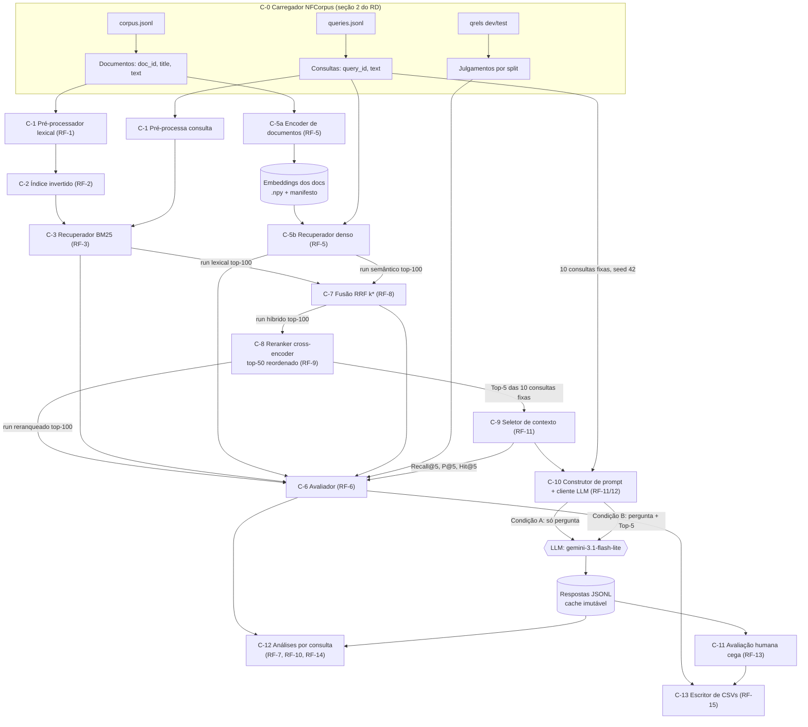
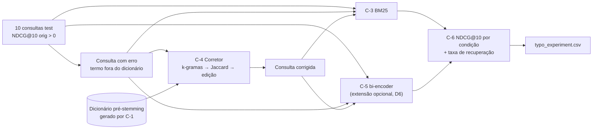

# Documento de Arquitetura — Trabalho Prático 2 (SCC0282, RI 2026)

> **Base:** `docs/t2_requisitos.md` (Requirements Document; referenciado como RF-N, C-N de restrição = "Cn" da seção 1 daquele documento) e `docs/t2_decisoes.md` (D1: BM25; D2: Gemini free tier; D3: restrição de modelos locais; D4: bi-encoder; D5: cross-encoder).
> **Revisão 11/11/2026 (22h30):** seções 0, 1.2, 3.1, 3.2, C-14 e riscos 1 e 4 atualizados após as decisões D3–D5 (modelos escolhidos a priori, sem comparação entre modelos).
> **Escopo:** arquitetura de alto nível, interfaces e seleção de modelos. Detalhes de implementação ficam para o TDS.
> **Data das verificações externas:** 11/11/2026. Valores não encontrados estão marcados `[VERIFICAR: …]`. Estimativas calculadas por mim estão marcadas *(estimativa)*.
> **Notação:** componentes = **C-N** (seção 2); restrições do enunciado = **Cn** (ex.: C4 = escolhas de modelo só no dev). Para evitar ambiguidade, as restrições são citadas como "restrição C4".

---

## 0. Princípio arquitetural que condiciona a seleção de modelos

A **restrição C4** (Metodologia) exige que a escolha de modelo de embeddings, de reranking, de pré-processamento e de parâmetros lexicais seja feita "com base no conjunto dev, e não pela comparação de alternativas no conjunto test".

**Como a arquitetura atende a isso (D3–D5):**
- O enunciado **não exige comparar modelos** (Req. 5 e Req. 9: "A escolha do modelo é livre"; o reranker só precisa ser "informado e justificado"). As comparações obrigatórias são entre **sistemas** (Req. 7–9).
- Os modelos são escolhidos **a priori**, por um critério que não usa nenhum resultado de avaliação: estar entre os indicados pelo professor ou na documentação do Sentence Transformers (D3) e rodar em CPU local (i5, 4 threads, 20 GB de RAM).
- Os resultados publicados no NFCorpus (MTEB/BEIR, medidos no split test) **não** são usados como critério nem citados como justificativa.
- O **dev** serve para **validar** cada modelo escolhido: o NDCG@10 no dev é reportado antes de qualquer execução no test. Também serve para ajustar o que o enunciado manda ajustar (k do RRF; limiares da correção; pré-processamento e k1/b, se alterados).
- **Ambiguidade residual registrada:** "com base no dev" também pode ser lido como "comparar alternativas no dev". A leitura adotada é que basta nenhuma decisão depender do test, e o relatório deve declarar isso.

A LLM (seção 3.3) não é coberta pela restrição C4 e é decidida aqui.

---

## 1. Diagrama de Pipeline

### 1.1 Pipeline principal (avaliação final no test)

### 1.2 Pontos de decisão no dev (executados antes do 1.1)

```mermaid
flowchart LR
    G["C-14 Orquestrador<br/>com trava de split"] --> S1
    S1["1. Pré-processamento<br/>(RF-1) e k1, b (RF-3)"] -->|"maior NDCG@10 dev"| S2
    S2["2. Validar bi-encoder fixo<br/>multi-qa-MiniLM-L6-cos-v1 (RF-5)"] -->|"reportar NDCG@10 dev"| S3
    S3["3. k do RRF<br/>10, 60, 100 (RF-8)"] -->|"maior NDCG@10 dev"| S4
    S4["4. Validar cross-encoder fixo<br/>ms-marco-MiniLM-L2-v2 (RF-9)"] -->|"reportar NDCG@10 dev"| S5
    S5["5. Limiares da correção<br/>(RF-4)"] --> F["Configuração congelada<br/>config.yaml + hash"]
    F --> T["Execução única no test"]
```

A **ordem é obrigatória**: o RRF depende dos dois rankings de entrada, e o reranking depende do ranking híbrido. Mudar um estágio anterior invalida os ajustes dos posteriores. Os passos 2 e 4 só validam: os modelos já estão fixados (D4, D5).

### 1.3 Experimento separado de tolerância a erros (RF-4; restrição C8)

A seleção das consultas e o ajuste dos limiares usam só o BM25 (RF-4 iii, iv). O bi-encoder recebe as mesmas três versões de cada consulta, como extensão opcional do RF-4 (D6, TDS-DEC-12).

---

## 2. Componentes do Sistema

**Tipos de interface comuns** (usados abaixo):
- `Docs = dict[doc_id: str, {"title": str, "text": str}]`
- `Queries = dict[query_id: str, str]`
- `Qrels = dict[query_id, dict[doc_id, int]]` (grau original), um por split
- `Run = dict[query_id, list[(doc_id: str, score: float)]]`, ordenado por score decrescente, com desempate determinístico por `doc_id`. O rank é implícito (posição + 1).
- `Split = Literal["dev", "test"]`

#### C-0 — Carregador do NFCorpus
- **RF de origem:** seção 2 do RD (Dataset e Splits); restrições C17 e C18.
- **Responsabilidade:** ler os arquivos oficiais do BEIR e expor documentos, consultas e qrels por split.
- **Entrada:** caminho do `nfcorpus.zip` extraído (`corpus.jsonl`, `queries.jsonl`, `qrels/{dev,test}.tsv`).
- **Saída:**
  - `Docs`;
  - `Queries` (todas as 3.237);
  - `Qrels[split]`;
  - `query_ids[split]` = consultas com julgamento naquele split;
  - `doc_text(doc_id) = title + " " + text` (representação única, C18).
- **Dependências:** nenhuma.
- **Restrição:** consultas de cada split = as que têm julgamento no qrels correspondente (Metodologia).

#### C-1 — Pré-processador lexical
- **RF de origem:** RF-1.
- **Responsabilidade:** transformar texto em tokens para o índice e as consultas, e gerar o vocabulário **pré-stemming** usado pelo C-4.
- **Entrada:** `str` (documento via `doc_text` ou consulta) e configuração `{lowercase, stopwords, stemmer|lemmatizer}`.
- **Saída:**
  - `list[str]` (tokens finais);
  - `list[str]` de tokens de superfície (antes do stemming), para o dicionário do RF-4.
- **Dependências:** C-0.
- **Restrição:** bibliotecas externas permitidas; configuração escolhida no dev (C4); mesma função para documentos e consultas.

#### C-2 — Índice invertido
- **RF de origem:** RF-2 (implementado; ver D1 e `t2_busca_lexical_bm25_contexto.md`).
- **Responsabilidade:** armazenar posting lists e as estatísticas exigidas pelo BM25.
- **Entrada:** `dict[doc_id, list[str]]` (saída do C-1).
- **Saída:**
  - `get_postings(term) → (doc_idx[], tf[])`;
  - `df(term)`;
  - `doc_lens[]`, `avgdl`, `N`, `doc_ids[]`;
  - `stats()`: vocabulário, postings, tempo de construção.
- **Dependências:** C-1.
- **Restrição:** do zero (C1); nada pronto que construa ou consulte o índice textual.

#### C-3 — Recuperador lexical BM25
- **RF de origem:** RF-3 (D1).
- **Responsabilidade:** pontuar só os candidatos das posting lists e devolver o top-k.
- **Entrada:** `list[str]` (consulta tokenizada pelo C-1), `k=100`, `(k1, b)`.
- **Saída:** `list[(doc_id, score)]` → agregado em `Run` lexical; `avg_query_time_ms`.
- **Dependências:** C-2.
- **Restrição:**
  - sem varredura dos N documentos (C2);
  - mesmo modelo em todos os experimentos (C6);
  - (k1, b) só no dev (C4).

#### C-4 — Corretor ortográfico
- **RF de origem:** RF-4.
- **Responsabilidade:** substituir termos fora do dicionário pelo candidato mais próximo.
- **Entrada:**
  - consulta crua (`str`);
  - dicionário pré-stemming (`set[str]` + índice de k-gramas, construídos a partir do C-1);
  - parâmetros `{k, limiar_jaccard, variante_edição}`.
- **Saída:** consulta corrigida (`str`) + log por termo `(termo_original, candidatos_filtrados, escolhido, distância)`.
- **Dependências:** C-1 (vocabulário de superfície), C-3 e C-6 (para avaliar); C-5 na extensão semântica opcional (D6).
- **Restrição:**
  - pipeline fixado em k-gramas → Jaccard → distância de edição;
  - dicionário anterior ao stemming;
  - parâmetros ajustados no dev;
  - experimento isolado (C8).

#### C-5 — Recuperação semântica (C-5a encoder; C-5b recuperador)
- **RF de origem:** RF-5.
- **Responsabilidade:** codificar os documentos offline e, por consulta, calcular a similaridade com todos eles.
- **Entrada:**
  - C-5a: `Docs` (representação conforme o modelo; ver 3.1);
  - C-5b: consulta (`str`) + matriz de embeddings.
- **Saída:**
  - C-5a: matriz `float32[N, d]` + manifesto (seção 4);
  - C-5b: `Run` semântico top-100;
  - tempos de codificação (total dos documentos e médio por consulta).
- **Dependências:** C-0.
- **Restrição:**
  - bi-encoder pré-treinado (sem treino);
  - busca exaustiva permitida;
  - modelo escolhido no dev (C4);
  - reportar os 9 itens do RF-5.

#### C-6 — Avaliador
- **RF de origem:** RF-6 (P@10, R@10, AP@10, NDCG@10) e RF-13 (Recall@5, P@5, Hit@5).
- **Responsabilidade:** calcular as métricas por consulta e agregadas segundo as convenções do RD (seção 4).
- **Entrada:** `Run`, `Qrels[split]`, `query_ids[split]`, corte k.
- **Saída:** `DataFrame[query_id, model, P10, R10, AP10, NDCG10]` + médias; para o RAG, `[query_id, R5, P5, Hit5]`.
- **Dependências:** C-0.
- **Restrição:**
  - relevante = grau > 0 (P, R, AP);
  - graus preservados e ganho linear no NDCG;
  - IDCG calculado a partir de **todos** os julgamentos;
  - denominador = total de relevantes nos qrels;
  - validação cruzada obrigatória com `ir_measures` (teste automatizado).

#### C-7 — Fusão RRF
- **RF de origem:** RF-8.
- **Responsabilidade:** combinar os rankings lexical e semântico por rank.
- **Entrada:** `Run_lex`, `Run_sem` (cada um truncado em 100) e `k`.
- **Saída:** `Run` híbrido (união de até 200 documentos), ordenado por RRF com desempate determinístico.
- **Dependências:** C-3, C-5.
- **Restrição:**
  - fórmula fixa; rank começando em 1;
  - documento ausente não recebe contribuição daquele sistema;
  - k escolhido no dev entre {10, 60, 100} e congelado (C7).

#### C-8 — Reranker
- **RF de origem:** RF-9.
- **Responsabilidade:** reordenar os 50 primeiros do híbrido com um cross-encoder, mantendo a ordem relativa das posições seguintes.
- **Entrada:** `Run` híbrido, `Docs`, `Queries`, `depth=50`.
- **Saída:**
  - `Run` reranqueado (50 reordenados + posições 51..100 do híbrido);
  - scores do cross-encoder para os 50;
  - tempo médio por consulta;
  - % de pares truncados.
- **Dependências:** C-7.
- **Restrição:** recuperador inicial = híbrido; modelo escolhido no dev (C4); reportar comprimento máximo e truncamento.

#### C-9 — Seletor de contexto
- **RF de origem:** RF-11, RF-12.
- **Responsabilidade:** montar o bloco de contexto com os Top-5 reranqueados e seus `doc_id`.
- **Entrada:** `Run` reranqueado (10 consultas fixas), `Docs`.
- **Saída:** `list[{doc_id, title, text}]` (5 itens) + `context_doc_ids`; alimenta o C-6 para Recall@5/P@5/Hit@5.
- **Dependências:** C-8.
- **Restrição:** unidade de contexto = documento do `corpus.jsonl` (C11); chunking só como opcional, preservando o `doc_id`.

#### C-10 — Construtor de prompt + cliente LLM
- **RF de origem:** RF-11, RF-12.
- **Responsabilidade:** gerar as condições A e B com a mesma LLM e os mesmos parâmetros, registrando tudo.
- **Entrada:** pergunta, contexto (só em B), configuração congelada `{model_id, temperature, seed, max_output_tokens, thinking, idioma}`.
- **Saída:** registro JSONL por chamada: `{query_id, condition, prompt, answer, model_id, modelVersion, params, usage, timestamp}`.
- **Dependências:** C-9.
- **Restrição:**
  - as 10 consultas fixas (C9);
  - mesma LLM e parâmetros em A/B (C10);
  - o prompt B contém as três instruções do RF-12;
  - chave de API fora do código (C15).

#### C-11 — Avaliação humana cega
- **RF de origem:** RF-13.
- **Responsabilidade:** produzir uma planilha cega de avaliação e reincorporar as notas.
- **Entrada:** JSONL do C-10 + Top-5 por consulta (para julgar a Fidelidade também na condição A).
- **Saída:**
  - planilha embaralhada **sem a condição** (seed registrada);
  - arquivo de mapeamento separado;
  - após a avaliação: notas 0/1/2 + justificativas;
  - Rastreabilidade "N/A" em A.
- **Dependências:** C-10.
- **Restrição:** critérios e regras do RD seção 5.3.

#### C-12 — Módulo de análises
- **RF de origem:** RF-7, RF-10, RF-14.
- **Responsabilidade:** selecionar as consultas de análise por regra determinística e montar as evidências.
- **Entrada:** métricas por consulta (C-6), runs de todos os estágios, `Docs`, estatísticas do índice.
- **Saída:**
  - RF-7: 3 + 3 consultas por ΔNDCG@10 (semântico − lexical) + Top-5 de cada método;
  - RF-10: 2 maiores ganhos, 1 sem alteração, 1 piora + documentos que mudaram de posição;
  - RF-14: rastreio por estágio (o documento útil estava no lexical, no semântico, no híbrido, no top-50 ou no Top-5?);
  - evidências numéricas (tf, df, |D|, rank, similaridade).
- **Dependências:** C-6, C-8, C-13.
- **Restrição:** afirmações só com valores observados (C19); sem comparar scores entre modelos (C20).

#### C-13 — Escritor de resultados
- **RF de origem:** RF-15.
- **Responsabilidade:** serializar os CSVs padronizados com colunas e cortes exigidos.
- **Entrada:** runs do test, métricas, registros do RF-4 e do RAG.
- **Saída:** os 7 CSVs do RD seção 6.1, com validação de schema e checagem `mean(AP10) == MAP@10`.
- **Dependências:** C-3, C-4, C-5, C-6, C-7, C-8, C-11.
- **Restrição:** top-100; arquivos fora dos notebooks (C12).

#### C-14 — Orquestrador de experimentos com trava de split
- **RF de origem:** restrições C3, C4, C5 e C7; RF-3, RF-4, RF-5, RF-8 e RF-9 (pontos de ajuste).
- **Responsabilidade:** executar os ajustes e validações no dev na ordem da seção 1.2, congelar a configuração e só então liberar o test.
- **Entrada:** grade de valores por estágio ajustável (k do RRF, limiares, pré-processamento, k1/b) e modelos fixos (D4, D5); `Split`.
- **Saída:** `config.yaml` congelado (com hash), tabelas de seleção do dev (CSV), runs do test.
- **Dependências:** todos os componentes de recuperação.
- **Restrição:** qualquer chamada de seleção com `split="test"` falha (trava programática); o test roda uma única vez com a configuração congelada.

---

## 3. Decisões de Modelo

### 3.1 Bi-encoder (embeddings) — RF-5

- **Função no pipeline:** recuperador denso de primeiro estágio. Codifica consulta e documento **separadamente** em vetores e ranqueia por similaridade. Os documentos são codificados uma vez (offline), o que permite comparar cada consulta com os 3.633 documentos de forma exaustiva.
- **Restrição desta seção (D3):**
  - apenas modelos locais indicados no enunciado ou na documentação do Sentence Transformers;
  - executáveis em **CPU local**: Intel i5, 4 threads, 20 GB de RAM.
- **Contexto do domínio `[EXTERNO]`:** consultas com média de **3,30 palavras**, documentos com **232,26 palavras** e **3 níveis** de relevância (BEIR, Tabela 1). Documentos ≈ 300–350 tokens WordPiece *(estimativa)*.

**Candidatos dentro da restrição** (tempo de CPU *estimado* pelo custo por documento; os tempos reais são medidos e reportados conforme o RF-5):

| Modelo | Dimensão | Max tokens | Domínio médico? | RAM (GB) *(pesos fp32, estimativa)* | Roda na CPU local? | Fonte |
|---|---|---|---|---|---|---|
| **`multi-qa-MiniLM-L6-cos-v1`** ✔ | 384 | 512 (treinado com 250) | Não (QA geral; inclui MS MARCO) | ~0,1 | Sim (~2–5 min para a coleção) | [HF card](https://huggingface.co/sentence-transformers/multi-qa-MiniLM-L6-cos-v1); [doc. ST](https://www.sbert.net/docs/sentence_transformer/pretrained_models.html) |
| `all-MiniLM-L6-v2` | 384 | 256 (treinado com 128) | Não | ~0,1 | Sim (~2–5 min) | [HF card](https://huggingface.co/sentence-transformers/all-MiniLM-L6-v2) |
| `multi-qa-distilbert-cos-v1` | 768 `[VERIFICAR]` | `[VERIFICAR]` | Não | ~0,3 | Sim (~10–15 min) | [doc. ST](https://www.sbert.net/docs/sentence_transformer/pretrained_models.html) |
| `multi-qa-mpnet-base-cos-v1` | 768 `[VERIFICAR]` | `[VERIFICAR]` | Não | ~0,4 | Sim (~20–30 min) | Idem |

Referência da documentação do Sentence Transformers (desempenho em 6 datasets / consultas por segundo em CPU):

| Modelo | Desempenho | Consultas/s (CPU) |
|---|---|---|
| multi-qa-MiniLM-L6-cos-v1 | 51,83 | 750 |
| multi-qa-distilbert-cos-v1 | 52,83 | 350 |
| multi-qa-mpnet-base-cos-v1 | 57,46 | 170 |

Nenhum modelo dentro da restrição é biomédico. O único "científico" da documentação, o `allenai-specter`, é treinado em citações (artigo → artigo), não em consulta → documento. Modelos biomédicos avaliados antes (MedCPT, S-PubMedBert) e generalistas fora da documentação (bge, e5, Qwen3-Embedding) foram **excluídos por D3**.

**Decisão (D4): `sentence-transformers/multi-qa-MiniLM-L6-cos-v1`**, escolhido a priori, sem comparação entre modelos (seção 0).

Justificativa para o relatório:
1. **Viabilidade:** é o modelo que roda na máquina disponível (CPU i5, 4 threads, 20 GB) em tempo compatível com o prazo. É o mais barato da família multi-qa.
2. **Indicado pelo professor** (Req. 5) e treinado especificamente para busca: ~215M pares pergunta–resposta, incluindo MS MARCO.
3. **Limite de 512 tokens**, que cobre o documento médio do NFCorpus. O `all-MiniLM-L6-v2`, a outra sugestão, trunca em 256.
4. **Embeddings normalizados:** produto interno = cosseno, sem etapa extra de normalização.

**Itens do RF-5 já conhecidos:**
- Biblioteca: Sentence Transformers.
- Dimensão: 384.
- Similaridade: cosseno (via produto interno de vetores normalizados).
- Normalização: sim (modelo).
- Comprimento máximo: 512.
- Medir na execução: tempo de codificação, tempo por consulta e % de documentos com mais de 512 tokens.

**Limitações a declarar:**
- Desempenho pode cair com textos longos: o card informa treino com até 250 word pieces.
- Modelo não especializado no domínio biomédico. Isso é material para a análise do RF-7 (termos técnicos e vocabulário médico).

**Reprodutibilidade:** fixar a revisão do modelo no Hugging Face e as versões de `torch`, `transformers` e `sentence-transformers`; salvar o manifesto (seção 4); `torch.set_num_threads` fixo.

### 3.2 Cross-encoder (reranking) — RF-9

- **Função no pipeline:** reranker de segundo estágio. Processa consulta e documento **juntos** (atenção cruzada em todas as camadas), o que é mais preciso e mais caro: um forward por par.
- **Custo:** 323 consultas × 50 = **16.150 pares** no test; mais 16.200 no dev para a validação.
- **Restrição desta seção:** D3 (mesmas regras do 3.1).
- **Truncamento:** a consulta (~5–10 tokens) e o documento (~300–350 tokens) **dividem** a janela, com 3 tokens especiais. O documento médio cabe em 512; a cauda longa é truncada *(estimativa)*. A % de pares truncados é medida pelo C-8 e reportada (RF-9).

**Candidatos dentro da restrição.** Família MS MARCO da documentação do Sentence Transformers (NDCG@10 TREC DL19 / MRR@10 MS MARCO dev / docs/s em V100); o tempo na CPU local é *estimado*.

| Modelo | NDCG@10 | MRR@10 | Docs/s (V100) | Max tokens | Domínio médico? | Tempo por split na CPU local |
|---|---|---|---|---|---|---|
| `ms-marco-TinyBERT-L2-v2` | 69,84 | 32,56 | 9.000 | `[VERIFICAR]` | Não | Muito rápido |
| **`ms-marco-MiniLM-L2-v2`** ✔ | 71,01 | 34,85 | 4.100 | 512 `[VERIFICAR: config do tokenizer]` | Não | ~5–10 min |
| `ms-marco-MiniLM-L4-v2` | 73,04 | 37,70 | 2.500 | Idem | Não | ~7–15 min |
| `ms-marco-MiniLM-L6-v2` (exemplo do enunciado) | 74,30 | 39,01 | 1.800 | Idem | Não | ~10–25 min |
| `ms-marco-MiniLM-L12-v2` | 74,31 | 39,02 | 960 | Idem | Não | ~20–50 min |
| `bge-reranker-*`, `mxbai-rerank-*` (seção "community" da doc.) | — | — | — | — | Não | 1,5 h a 9 h; inviável ou marginal |

Fontes: [doc. ST — Cross-Encoders](https://www.sbert.net/docs/cross_encoder/pretrained_models.html); [HF card L6](https://huggingface.co/cross-encoder/ms-marco-MiniLM-L6-v2).

**Decisão (D5): `cross-encoder/ms-marco-MiniLM-L2-v2`**, escolhido a priori, sem comparação entre modelos.

Justificativa para o relatório:
1. **Viabilidade:** é o reranker MiniLM mais rápido (4.100 docs/s na referência V100, ~2,3× o L6), adequado à CPU disponível e ao reranqueamento de ~32 mil pares (dev + test).
2. **Família indicada pelo professor** (Req. 9: exemplo `ms-marco-MiniLM-L6-v2`) e documentada no Sentence Transformers.
3. **Trade-off declarado:** na referência fora do domínio, o L2 tem 71,01 de NDCG@10 contra 74,30 do L6 (−3,3 pontos). Foi escolhido por custo, não por qualidade.

**Implicações para as análises:**
- Um reranker raso e sem especialização no domínio pode **piorar** o híbrido em parte das consultas. Isso é aceitável e alimenta diretamente o RF-10 (um caso de piora é obrigatório). Não se deve presumir ganho.
- Os scores são logits sem limite (aproximadamente −10 a 10, segundo a doc. ST). Não comparar com scores do bi-encoder nem do BM25 (C20).
- O `max_length` efetivo deve ser fixado explicitamente (512) e registrado, e não herdado de forma implícita.

### 3.3 LLM para RAG — RF-11 / RF-12

- **Função no pipeline:** gerador. Recebe a pergunta (A) ou a pergunta + Top-5 com `doc_id` (B) e produz a resposta, com citação das fontes em B.
- **Custo:** com o volume total fixo em 20 chamadas, custo e latência são secundários. Os critérios que importam são **reprodutibilidade** e **estabilidade do modelo** até a entrega.

#### Modelos locais

VRAM = só os pesos *(estimativa: fp16 = 2 bytes/parâmetro; Q4 ≈ 0,6 byte/parâmetro)*; somar ~1–2 GB de KV-cache para contextos de ~2K tokens. A T4 tem 16 GB e **não suporta bf16** (compute capability 7.5): carregar em fp16 ou quantizado `[VERIFICAR: estabilidade numérica em fp16 para modelos treinados em bf16]`.

| Modelo | Família | VRAM fp16 / Q4 (GB) | Roda T4? / A100? | Suporte a seed fixa | Fonte |
|---|---|---|---|---|---|
| Qwen3-4B (instruct) | Qwen | 8,0 / ~2,4 | Sim (fp16) / Sim | Sim (via runtime) | [ertas.ai](https://www.ertas.ai/best/best-small-llm-for-local-deployment) |
| Qwen3-8B | Qwen | 16,4 / ~4,9 | Só quantizado / Sim | Sim (via runtime) | Idem |
| Qwen3.5-9B | Qwen | ~18 / ~5,4 | Só quantizado / Sim | Sim (via runtime) | [the-decoder](https://the-decoder.com/?p=33933) `[VERIFICAR: ID exato no HF]` |
| Gemma 4 E2B (5,1B total, 2,3B efetivos) | Gemma | ~10,2 / ~3,1 | Sim / Sim | Sim (via runtime) | [Artificial Analysis](https://artificialanalysis.ai/de/articles/gemma-4-everything-you-need-to-know) |
| Gemma 4 E4B (8B total, 4,5B efetivos) | Gemma | ~16 / ~4,8 | Só quantizado / Sim | Sim (via runtime) | Idem |
| Llama 3.1 8B Instruct | Llama | 16 / ~4,8 | Só quantizado / Sim | Sim (via runtime) | [ertas.ai](https://www.ertas.ai/best/best-small-llm-for-local-deployment) |
| Mistral 7B Instruct | Mistral | ~14,4 / ~4,3 | Limítrofe; quantizado / Sim | Sim (via runtime) | `[VERIFICAR: versão vigente no HF]` |

Como fixar a seed em cada runtime:
- **Ollama:** parâmetro `seed`, documentado como "Sets the random number seed to use for generation"; `temperature` padrão 0,8 (passar 0 explicitamente).
- **vLLM:** `SamplingParams(seed=…)`.
- **HF `transformers`:** decodificação greedy (`do_sample=False`), que dispensa seed.
- **Ressalva:** em GPU, kernels não determinísticos podem variar entre execuções e hardwares. Registrar hardware e versões.

#### APIs comerciais

Preço de lista Standard, USD por 1M tokens, consultado em 11/11/2026.

| Provedor | Modelo | Preço input | Preço output | Suporte a seed | Free tier | Fonte (URL) |
|---|---|---|---|---|---|---|
| Google | `gemini-3.1-flash-lite` (stable; shutdown ≥ 07/05/2027) | 0,25 | 1,50 | Campo `seed` no `GenerationConfig`, best-effort ("will attempt") `[VERIFICAR empiricamente no Gemini Developer API]` | **Sim** | https://ai.google.dev/gemini-api/docs/pricing |
| Google | `gemini-3.5-flash-lite` (stable; thinking "On (minimal)" por padrão) | 0,30 | 2,50 | Idem | `[VERIFICAR: não listado na página de preços consultada]` | https://www.developersdigest.tech/models/gemini-3-5-flash-lite (fonte secundária) |
| Google | `gemini-3.5-flash` (requisições **roteadas automaticamente para `gemini-3.6-flash`**) | 1,50 | 9,00 | Idem | Sim | https://ai.google.dev/gemini-api/docs/pricing ; https://ai.google.dev/gemini-api/docs/deprecations |
| Google | `gemini-2.5-flash-lite` (legado: acesso **restrito a quem já usou**) | 0,10 | 0,40 | Idem | Sim (se acessível) | Idem |
| Google | Gemma 4 via Gemini API | Gratuito | Gratuito | `[VERIFICAR]` | Sim (sem plano pago) | https://ai.google.dev/gemini-api/docs/pricing |
| Anthropic | `claude-haiku-5-5` (≤ 100K de prompt) | 0,10 | 0,50 | `[VERIFICAR: parâmetro seed não encontrado na documentação consultada]` | Não | https://platform.claude.com/docs/en/about-docs/pricing |
| Anthropic | `claude-haiku-4-5` | 1,00 | 5,00 | Idem | Não | Idem |
| OpenAI | `gpt-6-luna` | 0,10 | 0,50 | `seed` existe no Chat Completions (best-effort); ausente na Responses API `[VERIFICAR: disponibilidade do gpt-6-luna no Chat Completions]` | Não | https://developers.openai.com/api/docs/pricing ; [fórum OpenAI](https://community.openai.com/t/support-for-seed-parameter-in-the-responses-api/1230489) |
| OpenAI | `gpt-6.1-terra` | 1,00 | 5,00 | Idem | Não | Idem |

**Custo estimado do experimento** *(estimativa)*:
- **Premissas:** 10 consultas × 2 condições; B = ~2.000 tokens de contexto + ~100 de instrução e pergunta; A = ~100; `max_output_tokens` = 512.
- **Total:** 22.000 tokens de entrada e ≤ 10.240 de saída. Os tokens de "thinking" contam como saída.

| Modelo | Custo (20 chamadas) |
|---|---|
| `claude-haiku-5-5` / `gpt-6-luna` | US$ 0,007 |
| `gemini-3.1-flash-lite` | US$ 0,021 pago / **US$ 0 no free tier** |
| `gemini-3.5-flash-lite` | US$ 0,032 |
| `claude-haiku-4-5` / `gpt-6.1-terra` | US$ 0,073 |
| `gemini-3.5-flash` | US$ 0,125 |

#### Recomendação final (RF-11/RF-12) — consistente com D2

**LLM = `gemini-3.1-flash-lite` via Gemini Developer API, free tier.**

Justificativa:
1. **Custo zero** com free tier confirmado na página de preços; o enunciado não exige serviço pago.
2. **Estabilidade até a entrega:**
   - modelo **stable**, com desligamento mais cedo em 07/05/2027, depois do prazo;
   - não sofre roteamento automático (diferente do `gemini-3.5-flash`, que é redirecionado para o 3.6 e quebra a reprodutibilidade);
   - não é legado de acesso restrito (diferente da família 2.5, limitada a quem já a usava).
3. **Reprodutibilidade dentro do possível numa API:**
   - `temperature=0`;
   - `seed` fixa no `GenerationConfig` (best-effort);
   - registro do `modelVersion` devolvido em cada resposta;
   - **cache imutável** das 20 respostas em JSONL: a avaliação humana e as análises trabalham sobre o cache, sem regenerar.
4. **Ressalvas a declarar no relatório:**
   - determinismo não garantido em API;
   - no free tier, o Google usa entradas e saídas para melhorar seus produtos (NFCorpus é público);
   - limites de taxa não publicados (ver no AI Studio).

**Plano B (pré-registrado):** se o free tier bloquear ou o `seed` for rejeitado, usar **Gemma 4 E4B (Q4) ou Qwen3-4B via Ollama** no Colab T4, com `temperature=0` e `seed=42`. É reprodutível de ponta a ponta, com pesos abertos e versionados. Pela restrição C10, a troca vale para **as duas condições** e exige regerar tudo.

**Pendências antes de rodar** (atualizam a D2):
- [ ] Confirmar no AI Studio o limite RPD do `gemini-3.1-flash-lite`.
- [ ] Testar o `seed`: 2 chamadas idênticas, comparar as saídas.
- [ ] Verificar se o modelo tem "thinking" e como fixar o nível.
- [ ] Definir o idioma das respostas.

---

## 4. Estratégia de Armazenamento

### 4.1 Embeddings dos documentos (C-5a)

**Formato:** `embeddings/{model_slug}/doc_emb.npy` (`float32[N, d]`, linhas na ordem de `doc_ids.json`).

**Por que este formato:**
- memória mapeável;
- sem dependência extra;
- N = 3.633 → no máximo ~15 MB para d = 1024 *(estimativa)*;
- dispensa índice ANN, porque a busca exaustiva é permitida (RF-5).

**Manifesto `manifest.json`:**
- `model_id` e **revisão** (commit hash do HF);
- biblioteca e versões;
- `max_seq_length`;
- pooling;
- normalização (sim/não);
- função de similaridade;
- prefixos e instruções usados;
- representação do documento (`title + text` ou par);
- nº de documentos truncados;
- tempo de codificação;
- hardware;
- hash SHA-256 do `.npy`.

**Regra:** se a configuração normaliza, as linhas já são gravadas L2-normalizadas, de modo que produto interno = cosseno.

**Entrega:** arquivo regenerável, **não entregue** (C14). O README indica o comando de geração.

### 4.2 Índice invertido (C-2)

- **Estrutura (já adotada; D1):**
  - dicionário `dict[str → (doc_idx: int32[], tf: int32[])]`, com posting lists ordenadas por `doc_idx`;
  - vetores globais `doc_ids[]`, `doc_lens: int64[]`, `avgdl`, `N`;
  - `df` derivado do tamanho da lista.
- **Persistência:** opcional, pois a construção é rápida.
  - Se persistido: um único arquivo serializado + hash da configuração do C-1 usada para gerá-lo.
  - Regenerável, **não entregue** (C14).
- **Índice auxiliar do C-4:** dicionário de superfície (pré-stemming) + índice de k-gramas `dict[kgrama → set[termo]]`, gerados pelo mesmo C-1 e versionados pelo mesmo hash de configuração.

### 4.3 Artefatos intermediários a persistir

| Artefato | Formato | Gerado por | Consumido por | Entregue? |
|---|---|---|---|---|
| Configuração congelada | `config.yaml` + hash | C-14 | Todos (test) | Sim (código) |
| Tabelas de seleção no dev (pré-proc., k1/b, bi-encoder, k do RRF, reranker, limiares) | CSV por estágio | C-14 + C-6 | Relatório (Avaliação) | Sim (evidência de C4) |
| Runs por sistema e split (`lexical`, `semantic`, `hybrid`, `reranking` × `dev`, `test`) | TREC run ou Parquet, top-100 (híbrido interno até 200) | C-3, C-5, C-7, C-8 | C-6, C-12, C-13 | Os do test via RF-15 |
| Scores do cross-encoder (cache) | Parquet `(query_id, doc_id, model_rev, score, n_tokens, truncated)` | C-8 | C-12 (RF-10), estatística de truncamento | Não (regenerável) |
| Tempos por etapa | JSON por execução | C-2, C-3, C-5, C-7, C-8 | Relatório (tempos) | Sim (pequeno) |
| Log do corretor | JSON por consulta | C-4 | `typo_experiment.csv`, análise | Sim (pequeno) |
| Respostas da LLM | **JSONL imutável** (prompt, resposta, `modelVersion`, parâmetros, uso de tokens, timestamp) | C-10 | C-11, C-12, `rag_experiment.csv` | Sim (sem credenciais) |
| Planilha cega + mapeamento | CSV + JSON de mapeamento separado, com seed do embaralhamento | C-11 | Avaliador humano | Sim |
| CSVs padronizados | 7 CSVs do RF-15 | C-13 | Correção | **Sim (obrigatório)** |

**Regra de proveniência:** todo artefato traz no nome ou em metadados o hash da configuração congelada que o produziu.

---

## 5. Riscos Arquiteturais

Ordenados por severidade.

| # | Risco | Interface ou restrição afetada | Impacto | Mitigação arquitetural |
|---|---|---|---|---|
| 1 | **Contaminação pelo test e justificativa de escolha fraca.** Os modelos foram escolhidos a priori, por viabilidade (D3–D5). O risco é: (a) citar rankings públicos do NFCorpus (medidos no test) como justificativa; (b) reajustar algo depois de ver o test; (c) o corretor entender "com base no dev" como exigência de comparar modelos. | C-14 ↔ C-5, C-8; restrições C3/C4 | Invalida a avaliação final (20%); pode descontar nos componentes semântico e reranking (10% cada) | Critério de escolha declarado e independente de resultados (seção 0); NDCG@10 no dev reportado para cada modelo antes do test; trava programática de split no C-14; `config.yaml` congelado com hash antes da execução única no test; relatório declara explicitamente a leitura adotada da restrição C4. |
| 2 | **Deriva e indisponibilidade da LLM por API.** Família 2.5 com acesso restrito a quem já usava; `gemini-3.5-flash` roteado automaticamente para outro modelo; `seed` best-effort; limites do free tier não publicados. | C-10 ↔ LLM; RF-12 (A/B com mesmo modelo e mesmos parâmetros) | Respostas não reproduzíveis; A e B gerados por versões diferentes; bloqueio por cota perto do prazo | `gemini-3.1-flash-lite` fixado (stable, sem roteamento); registrar `modelVersion` por chamada e falhar se A e B divergirem; cache JSONL imutável (gerar uma vez); plano B local pré-registrado (Ollama + seed). |
| 3 | **Menos de 100 candidatos no lexical.** O BM25 sobre o índice só pontua documentos com termo da consulta, e as consultas têm em média 3,3 palavras. | C-3 → C-7 (RRF), C-6 (P@10), C-13 (top-100) | CSV com menos de 100 linhas em algumas consultas; RRF com contribuição lexical parcial | Contrato do `Run` aceita `len ≤ 100`; o C-6 usa denominador fixo; o C-13 registra quantas consultas ficaram com < 100; decisão de preenchimento registrada como pendência no TDS. |
| 4 | **Janelas de entrada e modelos rasos.** O bi-encoder foi treinado com até 250 word pieces (limite de 512); o cross-encoder L2 divide 512 tokens entre consulta e documento e tem só 2 camadas; o prompt da LLM leva 5 documentos. | C-0 (`doc_text`) → C-5, C-8, C-9 | Truncamento ou degradação silenciosa distorcem a comparação lexical × semântico (RF-7) e a análise do reranking (RF-10); o reranking pode piorar o híbrido | O C-0 é a única fonte da representação do documento; C-5 e C-8 medem e persistem `n_tokens` e `truncated` por documento ou par; `max_length` fixado explicitamente; a hipótese de que o reranking melhora não é presumida, e o efeito é medido no dev e analisado no RF-10. |
| 5 | **Inconsistência de vocabulário entre C-1, C-2 e C-4.** O dicionário do corretor é pré-stemming e o índice é pós-stemming. Se a configuração do C-1 mudar no dev depois de gerar o dicionário ou selecionar as consultas do RF-4, os dois divergem; a consulta corrigida também precisa passar pelo mesmo C-1. | C-1 → C-2, C-4; RF-4 (ii) e (iii) | Erros que deixam de ser "fora do dicionário"; NDCG@10 original recalculado com outra configuração; taxa de recuperação inválida | Dicionário, índice e índice de k-gramas versionados pelo mesmo hash de configuração do C-1; o RF-4 roda só após o congelamento (passo 5 da seção 1.2); checagem automática de que cada termo com erro ∉ dicionário. |

---

## Fontes (verificadas em 11/11/2026)

**Datasets**
- BEIR, Tabela 1 (estatísticas do NFCorpus): https://arxiv.org/pdf/2104.08663

**Bi-encoders**
- Doc. Sentence Transformers — modelos pré-treinados: https://www.sbert.net/docs/sentence_transformer/pretrained_models.html
- Modelos abaixo (exceto os da família `sentence-transformers/`) foram avaliados na v1 deste documento e excluídos por D3:
- MedCPT Query / Article / Cross: https://huggingface.co/ncbi/MedCPT-Query-Encoder ; https://huggingface.co/ncbi/MedCPT-Article-Encoder ; https://huggingface.co/ncbi/MedCPT-Cross-Encoder
- MedCPT (paper): https://arxiv.org/abs/2307.00589
- bge-base-en-v1.5: https://huggingface.co/BAAI/bge-base-en-v1.5
- e5-base-v2: https://huggingface.co/intfloat/e5-base-v2
- all-MiniLM-L6-v2: https://huggingface.co/sentence-transformers/all-MiniLM-L6-v2
- multi-qa-MiniLM-L6-cos-v1: https://huggingface.co/sentence-transformers/multi-qa-MiniLM-L6-cos-v1
- S-PubMedBert-MS-MARCO: https://huggingface.co/pritamdeka/S-PubMedBert-MS-MARCO
- Qwen3-Embedding-0.6B: https://huggingface.co/Qwen/Qwen3-Embedding-0.6B

**Cross-encoders** (bge-reranker excluído por custo em CPU)
- Doc. Sentence Transformers — Cross-Encoders: https://www.sbert.net/docs/cross_encoder/pretrained_models.html
- ms-marco-MiniLM-L6-v2: https://huggingface.co/cross-encoder/ms-marco-MiniLM-L6-v2
- bge-reranker-v2-m3: https://huggingface.co/BAAI/bge-reranker-v2-m3

**Gemini**
- Preços: https://ai.google.dev/gemini-api/docs/pricing
- Depreciações: https://ai.google.dev/gemini-api/docs/deprecations
- Modelos: https://aistudio.google.com/docs/models
- Thinking: https://ai.google.dev/gemini-api/docs/thinking
- `modelVersion` na resposta: https://ai.google.dev/api/generate-content
- `seed` no schema: https://apis.io/schemas/google-gemini/google-gemini-generationconfig/

**Outras APIs**
- Anthropic: https://platform.claude.com/docs/en/about-docs/pricing
- OpenAI: https://developers.openai.com/api/docs/pricing

**Runtimes locais**
- Ollama (`seed`, `temperature`): https://docs.ollama.com/modelfile

**LLMs locais**
- Gemma 4: https://artificialanalysis.ai/de/articles/gemma-4-everything-you-need-to-know ; https://the-decoder.com/?p=33933
